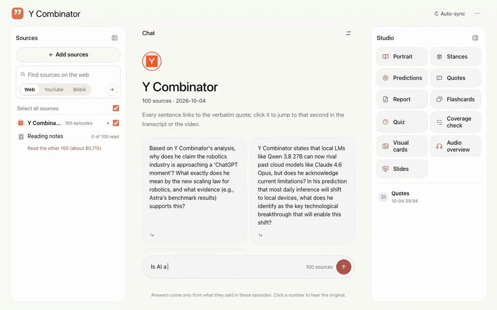
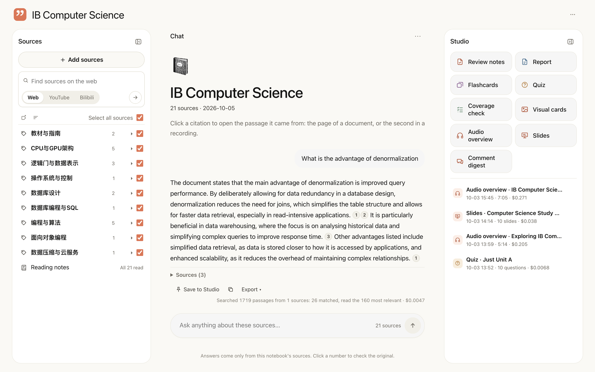

# Verbatim

**Hundreds of hours of audio/video, ask anything, and every sentence in the answer can be clicked to jump to the exact second of the original words.**

An open-source audio/video notebook that can run fully locally. The idea is similar to Gemini Notebook (previously NotebookLM), but enhanced for audio: it works with YouTube, Bilibili, class recordings and podcasts. It remembers who is speaking, and can turn a whole semester of class recordings into a revision guide, a quiz, and a podcast that explains the knowledge to you with your teacher's original voice clips inserted.



**[Quick start](#quick-start):** download the DMG (Apple Silicon Mac) or run `./install.sh` (macOS / Linux). Local Whisper transcription is free; questions and Studio need a Gemini API key, or your own local model through Ollama.

Author: Kerwin (Kapozux), Shanghai high schooler. Developed from March 2026 to now:

245 commits, 62 test suites, 1,500+ hours of audio processed so far.
Built with Claude Code as a development tool.



---

## Why I made it

I can't sit through an hour-long recorded stream, but I still want to know what is being talked about inside it. Current tools are either expensive or lack Chinese support, so I made my own.

Later it became my main tool for revision: I put class recordings and papers into the same notebook and ask something like "What is the definition of encapsulation?" After I click the citation in the answer, it brings me to the highlighted section of the CS book. I have used it every day for half a year.

## Difference from NotebookLM (as of October 2026)

| | NotebookLM | Verbatim |
|---|---|---|
| Click to the exact second | Subtitled YouTube videos only | YouTube, Bilibili and local audio/video all supported |
| Who is speaking | No identification | Local voiceprint identification: who is the teacher, the student, the reporter |
| Scale | 50–300 sources per notebook | Full YouTube channels, thousands of hours |
| Generated podcast | No sources | Inserts original audio clips, each section with its source |
| Model and data | Gemini only, data stored at Google | Open source, can run entirely on your device, your data is yours |
| For AI agents | No interface | MCP server published on PyPI, so Claude can transcribe and search your library for you |

## What it can do

**Notebook**: The left bar holds the Sources (audio/video, PDF, PPT, Word, websites), you ask questions in the middle, and the right section is the Studio.
Answers are based only on your material. Every sentence has its citation; click it to jump to the original sentence or the exact second of the audio/video.

**Studio**: One click to generate review notes, flashcards, quizzes, reports, slides and audio podcasts.
Every step shows the estimated cost first, then displays what it actually cost.

**Transcribe**: Paste a link or drag in a file. There are several transcription engines to choose from (local Whisper, Gemini, Qwen).
When an engine fails or runs out of quota, it automatically falls back to local Whisper without getting stuck.

**Creator Analysis**: Paste a YouTube channel link, and it will transcribe every episode and extract evidence cards (claim, original quote, timestamp). Then, based on the evidence cards, it writes a portrait of the creator: how their stance changes over time, whether their past predictions were accurate, and which claims they keep repeating.
New videos sync automatically. 85,000+ evidence cards generated so far (in my own library). See [Creators](docs/creators.md).

## Insight on tech

- **Process lives in code, not handed to the model.** Every multi-step task is a plain Python loop, and the model only focuses on a single step. So the results are reproducible, and errors can be located.
- **Using deterministic rules to clear hallucinations.** Merge repeated filler words, get rid of loops, fix timestamps; it only acts when multiple signals agree.
- **Evidence first, conclusion second.** Every episode is first compressed into neutral evidence cards, and the portrait can only reference evidence cards. Finally, a self-verification pass deletes claims that the cards don't support.
- **Cheap routing.** Daily tasks go to a cheap model first, and switch to an expensive one only when there's an error. Every token used and every cost is logged.
- **Engineering habits.** 62 automated test suites (all offline, no cost), ~50,000 lines of code.

## Quick Start

### Download the app (recommended)

1. Download `Verbatim.dmg` from [Releases](https://github.com/Kapozux/_Verbatim_/releases) (Apple Silicon Macs).
2. Drag Verbatim into Applications. It isn't signed, so the first time right-click it and choose **Open**.
3. **◉ Verbatim** appears in the menu bar and your browser opens the app. Add a Gemini API key in
   **Settings** for the cloud engines and creator analysis; local Whisper needs no key.

Your data stays in `~/Library/Application Support/Verbatim`. Full walkthrough:
[Getting started](docs/getting-started.md).

### Run from source

```bash
git clone https://github.com/Kapozux/_Verbatim_.git && cd _Verbatim_ && ./install.sh
```

`install.sh` installs whatever is missing (ffmpeg, yt-dlp and uv through Homebrew; its own Python 3.12 and the
dependencies into `venv/`, without touching your system Python), then starts Verbatim and opens
http://localhost:5001. Running it again is safe. Afterwards, start it with `bash getAudio/run.sh`.

On macOS you need [Homebrew](https://brew.sh); on Linux, install ffmpeg, yt-dlp and uv yourself first. It takes
about 1.3 GB, and local Whisper downloads its model (about 3 GB for large-v3) the first time you use it.

## Documentation

- [Getting started](docs/getting-started.md): install, first transcript, export
- [Engines](docs/engines.md): which transcription engine to use, keys, cost
- [Creators](docs/creators.md): the creator analysis workspace
- [FAQ](docs/faq.md): Gatekeeper, keys, download errors, data, uninstall

中文文档：[快速上手](docs/zh-CN/getting-started.md) · [转写引擎](docs/zh-CN/engines.md) ·
[博主分析](docs/zh-CN/creators.md) · [常见问题](docs/zh-CN/faq.md)

## Engines

| Engine | Good for |
|---|---|
| Whisper | Local and free (GPU-accelerated on Apple Silicon) |
| Gemini | Mixed Chinese/English |
| Gemini 3.5 | Tells speakers apart |
| QwenASR | Strong on Chinese |
| Precise | Hybrid: Gemini text + Alibaba speaker diarization |

Local Whisper transcription needs no API key. Summaries and creator analysis use Gemini; add keys in
Settings or in `getAudio/.env`:

```ini
GEMINI_API_KEY=...        # Gemini engines, summaries, analysis
DASHSCOPE_API_KEY=...     # QwenASR / Precise
OPENROUTER_API_KEY=...    # optional: Claude as the analysis model
```

## MCP Server

```bash
pipx install verbatim-transcribe-mcp
```

Claude Code and other agents can call Verbatim directly: transcribe links, search transcripts, run
creator analysis. The PyPI release has the transcription tools; the creator workspace tools (ask,
stances, predictions, recurring claims, radar) are in this repo for now — install them with
`pipx install -e verbatim-mcp`.

<details>
<summary><b>Known issues</b></summary>

- **Creator pipelines don't auto-resume** after a server restart. They're marked failed; click
  **Continue** to reuse everything already done and redo only what's missing.
- **Browser cookies for downloads.** Running from source, yt-dlp borrows Chrome's login cookies (skipped
  if Chrome isn't installed; change it with `YTDLP_COOKIES_BROWSER`). The app doesn't borrow cookies
  unless you set that variable, so a heavily rate-limited Bilibili channel may need a retry later.
- Gemini may block sensitive material; that file falls back to local Whisper instead of failing.
- The **Xiaohongshu tab** needs a companion scraper project (`XHS_PROJECT` env var) and `uv`. It's not a
  pip dependency, since it drives a real logged-in browser session.
- **Not built yet:** pipeline auto-resume across restarts, and Gemini Batch API for cheaper bulk analysis.

</details>

## License

MIT

---

*Transcription and analysis of third-party content is for private study. Respect the source platforms'
terms and creators' rights.*
